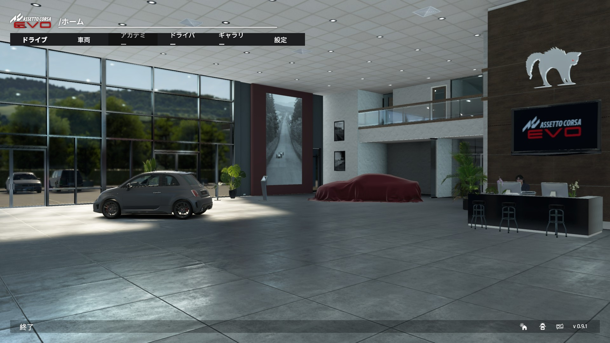

# Assetto Corsa EVO 日本語化パッチ（非公式）

Assetto Corsa EVO のメニュー・設定・ツールチップ・車のオプション名を日本語にします。
動作確認: **EVO 0.9.1**（Steam版）／Windows 11／Python 3.10

> ⚠️ **必ず「注意事項」を読んでから使ってください。** 非公式のファン作品で、ゲームの本体ファイルを書き換えます。自己責任です。

## ダウンロード

**[Releases（最新版）](https://github.com/texis324/ace-evo-ja/releases/latest)** から `EVO-Japanese-Patch_*.zip` をダウンロードし、展開して使います（リポジトリの「Code → Download ZIP」でも同じ中身です）。

## 使い方

必要なもの: Windows、Steam版の Assetto Corsa EVO、[Python 3.8 以上](https://www.python.org/downloads/)（インストール時に「Add python.exe to PATH」にチェック）

1. **EVO を完全に終了**します（Steam は起動したままで大丈夫です）。
2. このフォルダの **`1_日本語化する.bat`** をダブルクリックし、内容を確認して `y` を入力します。
3. EVO を起動し、**設定 → 言語** で **「日本語」** を選びます（元は「简体中文」の枠です）。

元に戻すときは、EVO を終了して **`2_元に戻す.bat`**。今の状態を見るだけなら **`0_状態確認.bat`**（何も書き込みません）。

コマンドで使う場合: `python evo_ja.py status | apply | verify | revert`（`--pkg "…\content.kspkg"` で場所を指定できます）。

## 仕組み

- EVO の文言は `uiresources\localization\<言語>.loc` から読み込まれます。言語は英・独・仏・伊・西・中の6つだけで、日本語はありません。
- 漢字・かなが出るフォントは言語が「cn」のときだけ使われます。そのため **cn（簡体中文）の枠に日本語を入れて**います。
- あなた自身のゲームから英語の文言を読み出し、同梱の `ja_translation.json`（キー → 日本語）を当てはめて作ります。**Kunos の英語原文はこのパッチに含まれません。**
- 日本語は英語より文字幅が広いため、メニューのタブで文字が折り返されないよう、**ゲームの `uicomponents.css` の行頭のインデントを削り、末尾にタブの余白を詰めるルールを1つ足します**（あなたのゲームのCSSから作るので、CSSそのものは同梱していません。元の枠に収まるよう、元より小さくなります）。
- 日本語が元の枠に入りきらない分は、使わない言語（フランス語・イタリア語・スペイン語・ドイツ語）の枠を借ります。**借りた範囲の元データは `backup` フォルダに退避**され、`revert` で完全に戻せます。

## 注意事項（重要）

- **非公式です。** Kunos Simulazioni とは無関係で、Kunos の許諾を得たものではありません。Assetto Corsa EVO の商標・著作権は各権利者に帰属します。
- **ゲームの本体ファイル（`content.kspkg`）を書き換えます。** Steam 版の利用規約（EULA）には、ゲームの改変や二次的著作物の作成を許可なく行ってはならないという趣旨の条項があります。**規約に反する可能性があることを理解した上で、自己責任で**使ってください。
- **オンライン機能（特別イベント・リーダーボード等）への影響は未検証です。** オンラインを使う前に、元に戻すことをおすすめします。
- **日本語化中は、フランス語・イタリア語・スペイン語・ドイツ語の表示が壊れます**（英語は影響を受けません）。
- **ゲームが更新されると、日本語化は消えるか、一部だけ残ります。** Steam で「ファイルの整合性を確認」→ `backup` フォルダを削除 → もう一度 `1_日本語化する.bat` を実行してください。翻訳データが新しい版に追いついていない行は、英語のまま表示されます。
- 書き込み前に `backup` を作りますが、**このフォルダは消さない**でください（消すと元に戻せません。その場合も Steam の整合性確認で元に戻せます）。
- 翻訳は **AI（Claude）が作成**し、実機で確認しながら調整しています。誤訳や不自然な表現があります。

## 既知の不具合

- 他の画面でも、日本語が枠からあふれる／折り返される表示があるかもしれません（メインメニュー上段は修正済み）。見つけたら、画面写真つきで教えてください。

## 更新履歴

- **v0.9.1.1**: メインメニュー上段・アカデミー画面のタブで、末尾の「ー」が次の行に落ちる問題を修正（タブの左右の余白を詰めるCSSを足します）。
  - **v0.9.1 を適用済みの方**: 古いフォルダで `2_元に戻す.bat` → 新しいフォルダで `1_日本語化する.bat` の順で更新してください（古いフォルダの `backup` を使って戻すため、先に古い方を実行します）。
- **v0.9.1**: 初回公開。

## 困ったとき

- **起動しない／表示が壊れた:** EVO を終了して `2_元に戻す.bat`。それでも直らなければ Steam で「ファイルの整合性を確認」。
- **`apply` が「他の言語ファイルに日本語が混ざっています」と止まる:** 前回の日本語化が残っています。Steam で整合性を確認してからやり直してください。
- **「Python が見つかりません」:** Python をインストールして（PATH に追加）、もう一度実行してください。

## ライセンス・クレジット

- コードと翻訳データは MIT ライセンスです（`LICENSE`）。
- `.kspkg` の形式の理解は、Nenkai 氏の [ACEvo.Package](https://github.com/Nenkai/ACEvo.Package)（MIT）の公開実装に拠っています。ありがとうございます（`NOTICE.md`）。
